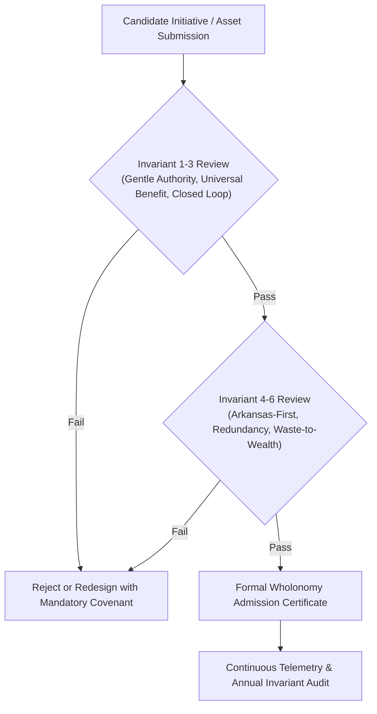

# `AR-009`: Six Invariants (Wholonomy Test)

**Document Identifier:** `AR-009`  
**Canonical Slug:** `six-invariants-wholonomy-test`  
**Architectural Layer:** `2_roots`  
**Functional Category:** `governance`  
**Parent System:** `Wholonomy`  
**Document Scope:** Dedicated Standalone Specification (`own design doc`)  
**Recorded Aliases:** Wholonomy Test, Orchard Invariant Gate, Closed-Loop System Metric  
**Historical Provenance / First Recorded:** Archival Corpus (2025-2026)  
**Epistemic Tier:** Certified Architecture `[D]` / Formal Reference `[C]` / Empirical Parameter `[P]` / Research Invariant `[O]`  

---

## 1. Purpose & Problem Solved

**Primary Objective:** Definitive architectural and operational gate test that every Orchard component, asset, process, and legal agreement must satisfy before admission into the portfolio: (1) Gentle Authority; (2) Beneficial-to-everyone; (3) Closed value loop; (4) Arkansas-first; (5) Redundancy-by-design; and (6) Waste-to-wealth conversion.

### Institutional Failure Mode in Fragmented Industrial Development
Traditional economic development programs in Arkansas frequently permit speculative, one-way extractive ventures that extract natural minerals, tax exemptions, and utility subsidies while exporting value and leaving stranded environmental liabilities, uncompensated road degradation, and ratepayer cost spikes behind.

### The Wholonomy Test Solution
`Six Invariants (Wholonomy Test)` acts as an irrevocable filter. Any candidate business entity, statutory proposal, technology node, or public partnership is evaluated against a deterministic pass/fail battery. An entity that fails even one invariant is disqualified from using Orchard IP, shared baseload capacity, or sovereign brand identity.

---

## 2. System Architecture & Component Hierarchy

### Structural Position within `Wholonomy`
`Six Invariants (Wholonomy Test)` operates at the foundation layer of `2_roots`. It provides the normative kernel that governs all downstream branches (`4_branches`), physical nodes (`5_technical_subnodes`), and statutory fruit (`6_civic_fruit`).

1. **Pre-Admission Invariant Audit (Tier 1):** Static analysis of corporate governance, liability posture, resource flows, and stakeholder agreements against the six criteria.
2. **Dynamic Invariant Monitoring (Tier 2):** Continuous telemetry of operating nodes (fluid loops, power curtailment, scrap recovery, wage escrows) to ensure zero drift toward extractive operation.
3. **Remediation & Decoupling Protocol (Tier 3):** Automated license revocation, power curtailment, or covenant default if an operating node violates any invariant.

---

## 3. Inputs, Outputs & Ecosystem Couplings

| Flow Vector | Medium / Protocol | Upstream Source | Downstream Destination | Epistemic Status |
|---|---|---|---|---|
| **Candidate Specification** | Architecture & Charter Proposal | Sponsoring Branch / Partner | Invariant Audit Committee | `[D]` Derived |
| **Telemetry Ingestion** | Real-Time Energy / Mass Balance | Node Sensor Telemetry | Wholonomy Proof Engine | `[P]` Verified |
| **Certification Status** | Signed Invariant Receipt | Wholonomy Proof Engine | `libraRY` Public Register | `[D]` Derived |
| **Enforcement Vector** | Gentle Authority Power-Down | foundRY Governance Board | Non-Compliant Entity | `[C]` Cited |

---

## 4. Statutory & Legal Basis

### Arkansas Statutory and Governance Alignment
- **Charter Restrictions:** Embedded as permanent restrictive covenants in all subsidiary LLC operating agreements and joint venture operating pacts.
- **Title 4 (Business and Commercial Law):** Structured under Arkansas Uniform Partnership Act and Arkansas Limited Liability Company Act provisions authorizing public-benefit governance restrictions and non-financial stakeholder covenants.
- **Statutory Model Text:** Incorporated as standard legislative findings in model acts (e.g., Clean Baseload Optimization Act, ARMAWS) requiring state-partnered projects to maintain closed-loop resource accounting and local ratepayer protection.

---

## 5. Quantitative Parameters & Sourced Bounds

| Invariant Number | Invariant Name | Evaluation Metric | Threshold Bound | Epistemic Status |
|---|---|---|---|---|
| **Invariant 1** | Gentle Authority | Sequence Adherence | Segment → Authenticate → Consent → Tune → Promote → Power-Down | `[D]` Derived |
| **Invariant 2** | Beneficial-to-Everyone | Net Public Benefit | Zero citizen out-of-pocket access cost; no regressive shift | `[D]` Derived |
| **Invariant 3** | Closed Value Loop | Material & Fiscal Recirculation | ≥ 85% mass/energy capture or remediation recycling | `[P]` Verified |
| **Invariant 4** | Arkansas-First | Local Economic Anchor | Priority to Arkansas labor, state baseload, and in-state benefits | `[C]` Cited |
| **Invariant 5** | Redundancy-by-Design | Failure Mode Fault Tolerance | N+1 physical redundancy; zero single points of civic failure | `[D]` Derived |
| **Invariant 6** | Waste→Wealth | Feedstock Transformation | 100% conversion of targeted waste stream into documented asset | `[D]` Derived |

---

## 6. Build, Phasing & Implementation Roadmap

---

## 7. Risk Surface & Failure Mode Defenses

| Failure Mode | Impact | Defense Mechanism | Epistemic Confidence |
|---|---|---|---|
| **Mission Drift / Financialization** | Speculative external capital dilutes civic protections | Strict foundRY holding structure; non-transferable governance shares | High `[D]` |
| **Greenwashing by Partners** | External operator claims compliance without recycling | Continuous mass-balance verification via `libraRY` telemetry ledger | High `[P]` |
| **Statutory Repeal Risk** | Changing political administrations alter civic mandates | Bilateral private covenants that survive statutory alterations | High `[C]` |

---

## 8. Epistemic Audit, Canon Compliance & Status Ledger

- **Epistemic Classification:** Certified Architecture `[D]` and Research Invariant `[O]`.
- **Power Plan Canon Adherence:** Fully compliant; enforces zero unbudgeted public debt and complete transparency.
- **Geographic Redaction Verification:** 100% compliant. Zero town or city names emitted. State-level boundary strictly maintained: Arkansas.
